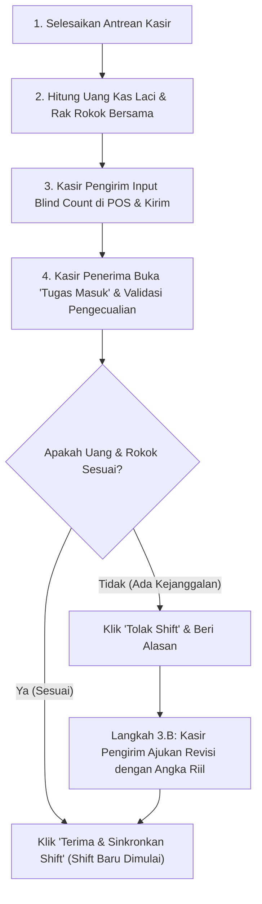
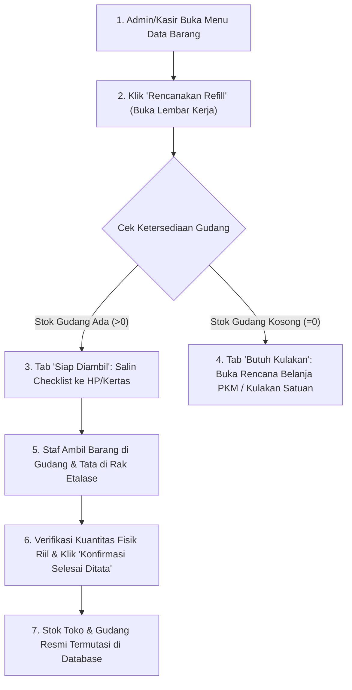
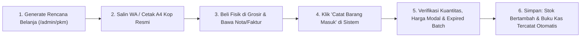

# STANDAR OPERASIONAL PROSEDUR (SOP)
## OPERASIONAL SERAH TERIMA SHIFT & REKONSILIASI KASIR
**KOPERASI KARYAWAN PKPPK BTH**
*Dokumen Resmi Operasional Kasir — Versi 2.1 (Terintegrasi POS & Sistem PKM)*

---

## 1. TUJUAN & RUANG LINGKUP
SOP ini bertujuan untuk:
1. Memastikan **kelancaran transisi pergantian shift kasir** yang cepat (target: 3–5 menit) tanpa menghambat antrean transaksi pembeli.
2. Mencegah terjadinya **kehilangan barang (*shrinkage*)** dan **selisih uang kas laci** melalui mekanisme pengawasan silang (*dual verification*).
3. Menerapkan prinsip **Blind Stock Count (Audit Buta)** dan **Teori PKM (Penetapan Kuantitas Maksimum 4 Hari)** agar kasir tidak terbebani menghitung stok berlebih saat pergantian shift.
4. Memberikan kepastian hukum dan pertanggungjawaban finansial yang jelas dan transparan atas setiap selisih yang terjadi (baik selisih kurang/minus maupun selisih lebih/plus).

---

## 2. PRINSIP DASAR & KONTROL SISTEM

### A. Teori PKM (Penetapan Kuantitas Maksimum Display Toko 4 Hari)
* **Konsep:** Barang yang ditata di meja/etalase kasir dibatasi sesuai kuantitas penjualan 4 hari:
  $$\text{PKM Toko} = \max(1, \lceil \text{Average Daily Sales (ADS)} \times 4 \text{ Hari} \rceil)$$
* **Tujuan:** Kasir hanya bertanggung jawab menghitung barang yang berada di area etalase/meja toko sesuai batas PKM. Barang cadangan tetap berada di gudang tertutup.

### B. Blind Stock Count (Audit Buta Kasir)
* Saat kasir keluar mengisi formulir serah terima, **angka stok sistem disembunyikan**.
* Kasir pengirim wajib menginput jumlah fisik riil dengan mata dan tangan sendiri. Hal ini mencegah kasir menyamakan angka fiktif untuk menutupi kehilangan barang.

### C. Exception Verification (Verifikasi Cepat Berbasis Pengecualian)
* Kasir penerima **TIDAK PERLU menghitung ulang semua barang yang sudah cocok**.
* Kasir penerima hanya memverifikasi:
  1. **Uang Fisik Kas Laci (Rp)**
  2. **Barang Kategori Rokok (High Risk)**
  3. **Barang yang Mengalami Selisih (Ditandai Merah/Biru oleh Sistem)**

---

## 3. ALUR OPERASIONAL SERAH TERIMA SHIFT (5 LANGKAH)

### Langkah 1: Persiapan & Cut-off Shift (Kasir Pengirim)
1. 5 menit sebelum jam pergantian shift, Kasir Pengirim menyelesaikan pembayaran seluruh anggota yang sedang mengantre di kasir.
2. Kasir Pengirim membuka menu **Operasional Shift ➔ Formulir Serah Terima Shift** di aplikasi POS ([/kasir/serah-terima/buat](http://localhost:5173/kasir/serah-terima/buat)).

### Langkah 2: Audit Bersama di Meja Kasir (3 Menit)
1. **Kasir Pengirim** dan **Kasir Penerima** berdiri bersama di meja kasir.
2. Kasir Pengirim menghitung uang tunai kas di laci kasir disaksikan langsung oleh Kasir Penerima.
3. Kasir Pengirim dan Penerima bersama-sama memeriksa fisik barang di rak rokok dan etalase PKM.

### Langkah 3: Penginputan Formulir Blind Count (Kasir Pengirim)
1. Pilih nama **Kasir Penerima Shift**.
2. Masukkan **Jumlah Uang Fisik Kas Laci (Rp)** yang baru saja dihitung bersama.
3. Masukkan **Hitungan Fisik Riil** untuk seluruh item etalase toko.
4. Tulis catatan kasir bila ada (misal: titipan uang receh koin, barang retur, dll.).
5. Klik **"Kirim Serah Terima Shift"**.

### Langkah 4: Validasi & Approval Instan (Kasir Penerima)
1. Kasir Penerima membuka menu **Operasional Shift ➔ Tab Tugas Masuk** di akun kasirnya ([/kasir/serah-terima](http://localhost:5173/kasir/serah-terima)).
2. Klik tombol **"Lihat & Validasi Rincian →"** pada tugas serah terima yang masuk.
3. Periksa layar ringkasan:
   * Cocokkan nominal uang kas laci.
   * Periksa bagian item yang memiliki tanda **Selisih (Merah/Biru)** atau **Rokok**.
4. Jika fisik di meja kasir sesuai dengan angka yang diajukan:
   * Klik **"Terima & Sinkronkan Shift"**.
   * Stok sistem otomatis diselaraskan dan shift kasir baru resmi dimulai.
5. Jika Kasir Pengirim menginput angka yang tidak sesuai dengan fisik di meja kasir:
   * Kasir Penerima klik **"Tolak Shift"** dan ketik alasan penolakan secara spesifik (Contoh: *"Fisik Samsu di etalase hanya 5 bungkus, bukan 10 bungkus"*).
   * **Stok database TIDAK disinkronkan**, dan tanggung jawab selisih tetap terkunci pada Kasir Pengirim.

### B. Prosedur Penyelesaian Pasca Penolakan Shift (Agar Shift Baru Bersih):
Setelah shift ditolak, Kasir Pengirim **TIDAK BOLEH meninggalkan meja kasir**. Wajib diselesaikan melalui salah satu dari 2 jalur:

1. **Jalur Normal (Revisi & Ajukan Ulang / Re-submit):**
   * Kasir Pengirim dan Kasir Penerima melakukan hitung ulang bersama.
   * Kasir Pengirim mengakui kondisi riil dan membuka kembali formulir serah terima, menginput angka fisik riil yang sebenarnya (Contoh: `Samsu = 5`).
   * Sistem akan otomatis mencatat selisih minus ($-5\text{ pcs}$ / senilai kerugian Rp 110.000) **atas nama Kasir Pengirim**.
   * Kasir Penerima menyetujui (*Approve*) pengajuan revisi tersebut.
   * **Hasil:** Stok database otomatis disinkronkan menjadi 5 pcs. Kerugian tercatat atas nama Kasir Pengirim, dan **Kasir Penerima memulai shift barunya dengan modal stok bersih (5 pcs)** tanpa risiko terbebani selisih kasir sebelumnya!

2. **Jalur Eskalasi ke Admin (Jika Terjadi Sengketa / Kasir Tidak Mengakui):**
   * Jika Kasir Pengirim menolak mengakui kekurangan barang/uang, laporkan langsung ke Admin/Pengurus Koperasi.
   * Admin memeriksa rekaman riwayat transaksi/CCTV dan melakukan penyesuaian stok melalui menu Admin Opname, serta menerbitkan Berita Acara Selisih Kasir untuk membebankan kerugian ke Kasir Pengirim.

---

## 4. PENANGANAN TRANSAKSI MASUK SAAT SERAH TERIMA

Jika ada anggota yang mendesak ingin berbelanja saat proses serah terima sedang berlangsung:

| Situasi | Prosedur Operasional |
| :--- | :--- |
| **Antrean Normal (1–2 Menit Sebelum Serah Terima)** | Kasir Pengirim menuntaskan transaksi sebelum menekan tombol formulir serah terima. |
| **Transaksi Mendadak Saat Hitung Bersama** | Transaksi langsung diproses menggunakan **Akun Kasir Penerima (Kasir Baru)**. Uang pembayaran dan pengurangan stok otomatis masuk ke buku shift Kasir Baru sehingga tidak mengganggu audit shift Kasir Pengirim. |

---

## 5. PERTANGGUNGJAWABAN & PENYELESAIAN SELISIH (VARIANCE)

Setiap selisih (*variance*) yang timbul pada saat serah terima shift diklasifikasikan dan diselesaikan sebagai berikut:

### A. Selisih Uang Kas Laci Minus (Cash Shortage / Kurang Uang)
* **Kewajiban:** Kasir Pengirim wajib **mengganti tunai kekurangan kas laci seketika** sebelum meninggalkan meja kasir agar modal kas awal untuk Kasir Penerima tetap utuh.

### B. Selisih Uang Kas Laci Lebih (Cash Overage / Kas Lebih)
* **Penyebab:** Kasir lupa menginput transaksi tunai ke POS, salah memberi uang kembalian (kurang kembalian ke pembeli), atau uang pribadi/receh titipan.
* **Perlakuan Akuntansi:** 
  1. **Dilarang Keras:** Kasir **DILARANG mengambil uang lebih** untuk kepentingan pribadi.
  2. Seluruh uang fisik lebih wajib diserahkan kepada Kasir Penerima dan tercatat di sistem sebagai `+Rp X (Kas Lebih)`.
  3. Uang lebih akan disetorkan ke Admin saat Setoran Kas dan diakui sebagai pos **Pendapatan Selisih Kas / Pendapatan Lain-Lain Koperasi**.

### C. Selisih Barang Hilang / Minus (Kategori Rokok & Nilai Tinggi)
* **Penyebab:** Kelalaian kasir saat melayani transaksi (misal: barang terambil tapi tidak ter-scan di POS).
* **Konsekuensi:** 
  1. Riwayat minus permanen tercatat di log database atas nama `kasir_from`.
  2. Admin akan merekap akumulasi minus bulanan melalui menu **Laporan Selisih Kasir** untuk diberlakukan **Potongan Selisih Kasir** (*Payroll Deduction*).

### D. Selisih Barang Surplus / Lebih (Stock Overage)
* **Penyebab:** 
  * *Salah Scan / Cross-Scanning:* Pembeli membeli Rasa Cokelat tapi kasir men-scan Rasa Stroberi (sehingga Cokelat minus 1, Stroberi plus 1).
  * *Barang Masuk Belum Tercatat:* Admin/Gudang menaruh barang ke etalase toko sebelum meng-input restock di sistem.
* **Penyelesaian:**
  1. Sistem otomatis memperbarui stok sistem menjadi sesuai stok fisik aktual (`stok = stok_aktual`) agar kasir tidak terhalang menjual barang tersebut di POS.
  2. Nilai surplus dicatat sebagai **Penyesuaian Persediaan Surplus (*Inventory Gain*)**.
  3. Jika terjadi *Cross-Scanning* (varian sejenis satu plus, satu minus dengan harga sama), Admin dapat melakukan kompensasi selisih silang tanpa membebani kasir.

### E. Barang Rusak / Kadaluarsa / Telur Pecah (Penyusutan Wajar)
* **Prosedur:**
  1. Kasir Pengirim menuliskan keterangan pada kolom catatan (Contoh: *"2 butir telur pecah saat penataan"* atau *"1 botol susu bocor kemasan"*).
  2. Fisik barang yang rusak wajib disimpan sebagai bukti fisik verifikasi.
  3. Admin Koperasi akan menyetujui penghapusan persediaan sebagai pos **Biaya Penyusutan Persediaan (*Inventory Shrinkage Write-off*) Koperasi**, bukan dibebankan ke kasir pribadi.

---

## 6. PROSEDUR PENARIKAN TUNAI & SALDO SHU KASIR

Untuk menjaga likuiditas kas toko dan memastikan keadilan pembagian SHU tahunan (*Win-Win Solution*), layanan penarikan tunai di kasir POS diatur sebagai berikut:

### A. Syarat Mutlak Kontribusi Belanja & Bebas Hutang (4-Layer Protection)
1. **Bebas Hutang:** Anggota dengan saldo hutang berjalan (`hutang > 0`) **dilarang tarik tunai**. Saldo SHU hanya dapat digunakan untuk melunasi tagihan hutang.
2. **Syarat Belanja:** Penarikan tunai kasir **wajib disertai dengan transaksi belanja produk toko minimal Rp 25.000** pada hari yang sama.
3. **Plafon Proporsional:** Maksimal nominal penarikan kasir adalah **$2 \times$ nilai belanja hari ini** (Plafon Maksimal Rp 100.000/hari di kasir POS).
4. **Pre-Verification Otomatis:** Sistem memverifikasi seluruh syarat di akun anggota sebelum tiket penarikan (`#TRK-ID`) diterbitkan untuk diproses di kasir.

### B. Kebijakan Pakta Integritas / Master Consent SHU 1x di Awal (Opsi 2)
1. Anggota menandatangani/menyetujui **Pakta Integritas Persetujuan Sadar Pengurangan SHU (Master Consent)** cukup **1 kali saja di awal** melalui aplikasi anggota.
2. Setelah Master Consent tercatat di sistem (`persetujuan_shu_master_at`), penarikan berikutnya langsung diproses otomatis tanpa perlu mencentang ulang setiap kali transaksi.
3. Penarikan SHU tercatat permanen di audit trail dan otomatis mengurangi jatah hak dividen pada saat pembagian SHU **Hari Raya / RAT Tahunan**.

### C. Prosedur Konversi & Distribusi SHU ke Saldo Belanja Toko oleh Admin (Closed-Loop Economy)
1. **Distribusi Massal Hari Raya:** Menjelang Idul Fitri / Natal / RAT, Admin Koperasi dapat mendistribusikan jatah SHU (misal 50% atau 100%) langsung ke **Saldo E-Wallet Belanja** seluruh anggota secara serentak.
2. **Keuntungan Kas Koperasi:** Dana SHU tidak terkuras keluar dari koperasi, melainkan langsung dibelanjakan kembali oleh anggota untuk sembako dan produk toko koperasi (*Closed-Loop Circulation*).
3. **Kompensasi Hutang Otomatis:** Admin dapat mengeksekusi pemotongan saldo SHU anggota untuk melunasi tagihan hutang yang menunggak secara otomatis.

### D. Mekanisme Penarikan Berulang & Potong Belanja Langsung (Net Cash Handover)
1. **Belanja Menyertai Setiap Penarikan:** Jika anggota ingin melakukan penarikan tunai lebih dari satu kali dalam sehari, setiap penarikan **wajib disertai dengan transaksi belanja baru minimal Rp 25.000**.
2. **Potong Belanja Otomatis di Kasir (Cashback Model):**
   * Transaksi belanja langsung dipotong dari saldo penarikan SHU anggota.
   * Kasir hanya mengeluarkan dan menyerahkan uang kas fisik bersih ke tangan anggota:
     $$\mathbf{\text{Uang Fisik Diserahkan}} = \mathbf{\text{Nominal Tarik SHU}} - \mathbf{\text{Total Tagihan Belanja Toko}}$$
   * *Contoh:* Anggota belanja Rp 30.000 dan menarik SHU Rp 100.000 $\rightarrow$ Saldo SHU anggota terpotong Rp 100.000, Belanja lunas Rp 30.000, Kasir hanya menyerahkan uang tunai Rp 70.000. Laci kasir toko tetap aman dari *cash drain*.

### E. Penanganan Pengajuan Gagal / Penolakan Otomatis & Pembatalan Kasir (Auto-Rejection & Full Refund)
1. **Pencatatan Otomatis Pengajuan Gagal (Auto-Rejection Log):**
   * Jika anggota mengajukan penarikan mandiri namun tidak memenuhi salah satu dari verifikasi 4-tahap (misal masih ada hutang atau belum belanja), sistem **tetap mencatat transaksi** tersebut di tabel database `tarik_tunai` dengan status **`rejected`** dan mengisi **`alasan_tolak`** otomatis dari sistem.
   * Hal ini memastikan seluruh upaya penarikan terekam transparan pada riwayat anggota dan laporan audit pengurus koperasi.
2. **Mekanisme Pembatalan oleh Kasir (100% Refund & Stock Recovery):**
   * Jika kasir menolak pesanan belanja yang menyertakan tarik tunai (karena stok fisik toko habis, laci kasir kurang kas, atau pembatalan anggota):
     - Stok barang toko **otomatis dikembalikan ke rak** (`stok += jumlah`).
     - Saldo SHU / E-Wallet anggota yang dipotong **langsung dikembalikan 100% utuh** ke akun anggota.
     - Status transaksi diubah menjadi `batal` dan status tiket penarikan menjadi `rejected`.

### F. Kebijakan Belanja Khusus Anggota & Struktur Plafon Kredit (Member-Only & Credit Allowance)
1. **Belanja 100% Khusus Anggota Koperasi (Member-Only) & Strict Limit Stok Etalase:**
   * Seluruh transaksi kasir toko (Tunai, QRIS, Transfer, Saldo E-Wallet, maupun Hutang) **wajib dikaitkan dengan Anggota Koperasi resmi terdaftar**.
   * Opsi pembeli non-anggota/umum telah dihapus permanen dari sistem POS demi akurasi pencatatan SHU dan integritas tata kelola koperasi.
   * **Aturan Transaksi Kasir POS & App Anggota:** Layar POS Kasir dan Katalog Belanja Anggota **HANYA menampilkan dan mengizinkan penjualan barang yang stoknya tersedia di rak etalase (`stok_toko > 0`)**. Walaupun stok di gudang melimpah, sistem akan memblokir penjualan jika stok rak habis, memaksa kasir untuk memindahkan fisik barang dari gudang ke etalase secara sistem terlebih dahulu.
2. **Struktur Agunan & Allowance Fasilitas Kredit (Dual-Limit Engine):**
   * **Plafon Kasir POS (Dinamis Berbasis Agunan):**
     - **Simpanan Pokok:** Agunan dasar (misal Rp 300.000).
     - **Allowance Koperasi:** Tambahan pagu **+ Rp 100.000** bagi anggota.
     - Sisa limit pada kasir dihitung otomatis: `(Simpanan Pokok + Allowance 100.000) - Hutang Berjalan`.
   * **Plafon Checkout App Anggota (Limit Hard-Cap):** 
     - Transaksi kasbon yang diproses langsung oleh anggota via *smartphone* dibatasi mutlak maksimal tagihan berjalan **Rp 600.000**.
   * Kasir dan sistem POS secara otomatis menolak transaksi kasbon baru jika tagihan melebihi sisa pagu kredit masing-masing otorisasi.

---

## 7. PANDUAN PRAKTIS KASIR (DO'S & DON'TS)

### ✅ YANG WAJIB DILAKUKAN (DO'S):
1. **Wajib hadir 5 menit sebelum pergantian shift** untuk melakukan hitung bersama di meja kasir.
2. **Wajib menginput hitungan fisik riil** tanpa menebak-nebak atau memperkirakan angka.
3. **Wajib mencatat "Refill / Mutasi Rak" di sistem terlebih dahulu** apabila mengambil barang dari gudang cadangan untuk dijual, karena mesin POS akan menolak *scan barcode* jika stok etalase tercatat kosong.
4. **Wajib menjaga kerapian etalase rokok** sesuai urutan agar proses hitung berlangsung cepat (< 1 menit).
5. **Wajib memeriksa uang palsu** saat menerima pembayaran tunai dari pembeli.

### ❌ YANG DILARANG KERAS (DON'TS):
1. **Dilarang melakukan serah terima secara sepihak** tanpa kehadiran kasir penerima di meja kasir.
2. **Dilarang meminjamkan akun login kasir** kepada kasir lain.
3. **Dilarang mengambil uang lebih kas laci** untuk keperluan pribadi.
4. **Dilarang menerima shift jika terdapat selisih uang/rokok** yang belum disepakati atau belum diganti oleh kasir sebelumnya.
5. **Dilarang menyimpan uang pribadi** di dalam laci kasir koperasi.

---

## 8. STRUKTUR KEANGGOTAAN & TATA KELOLA JABATAN (ROLE MANDATE ENGINE)

Untuk menjunjung tinggi prinsip dasar jati diri koperasi *"Dari Anggota, Oleh Anggota, Untuk Anggota"*, sistem otorisasi dan penugasan staf diatur sebagai berikut:

### A. Hakikat Keanggotaan Tunggal (Unified Identity Layer)
1. **Semua Pengelola adalah Anggota Resmi:** Seluruh staf internal (Admin Utama, Petugas Kasir Toko, dan Pengurus Koperasi) wajib terdaftar secara sah dalam Buku Daftar Anggota Koperasi (`anggota`).
2. **Hak Finansial Melekat:** Setiap kasir dan admin tetap berhak atas:
   - Kepemilikan Simpanan Pokok (Agunan Fasilitas Belanja Rp 300.000).
   - Hak Akumulasi dan Pembagian Sisa Hasil Usaha (SHU) Tahunan.
   - Pagu Limit Kredit Kasbon Anggota (Maksimal Rp 400.000).

### B. Mekanisme Mandat Jabatan Dinamis (Dynamic Role Mandate Engine)
1. **Pemisahan Akun & Mandat:** Jabatan kasir atau admin bukanlah kasta akun yang statis, melainkan **Mandat Penugasan Terjadwal** yang dicatat di sistem melalui menu Admin: **Jabatan & Mandat** ([/admin/jabatan](http://localhost:5173/admin/jabatan)).
2. **Penugasan Mandat (Assign Mandate):** Admin Koperasi dapat menunjuk anggota koperasi resmi untuk mengemban tugas sebagai Kasir POS atau Admin Operasional disertai catatan Surat Keputusan (SK) atau jadwal shift.
3. **Pencabutan / Rotasi Mandat (Revoke Mandate):**
   - Apabila seorang kasir purna tugas atau dirotasi ke posisi lain, Admin cukup menonaktifkan mandat jabatan terkait.
   - **Jaminan Keamanan Data:** Pencabutan mandat **TIDAK PERNAH** menghapus akun login, saldo tabungan, riwayat transaksi, maupun hak SHU anggota. Akun bersangkutan otomatis kembali beroperasi sebagai Anggota biasa.

### C. Perlindungan Sistem Kritis (Last Admin Safety Lock)
1. Sistem database dan backend secara otomatis menolak dan memblokir pencabutan mandat atau penghapusan akun Admin jika hanya tersisa 1 Admin aktif di sistem.
2. Hal ini mencegah kekosongan otoritas manajemen (*administrative lockout*) dalam tata kelola aplikasi koperasi.

---

### 9. MANAJEMEN INVENTORI 2-TIER, KADALUARSA (FEFO), & PICKING REFILL TOKO (ADMIN & GUDANG)

Untuk menjaga akurasi pembukuan, mencegah kerugian susut (*shrinkage/waste*), dan memastikan kelancaran operasional harian kasir, pengelolaan persediaan barang diatur sebagai berikut:

### A. Model Inventori 2-Tier (Display Toko vs Cadangan Gudang)
1. **Pemisahan Fisik & Sistem (Strict Isolation):**
   * **🏪 Stok Display Toko (`stok_toko`):** Persediaan barang yang dipajang di rak/etalase kasir. **Hanya stok inilah yang 100% berhak dijual oleh Kasir POS maupun dipesan oleh Anggota**. Kuantitas dibatasi maksimal sebesar **Penetapan Kuantitas Maksimum (PKM 4 Hari)**. Stok ini menjadi objek audit saat serah terima shift kasir.
   * **📦 Stok Cadangan Gudang (`stok_gudang`):** Persediaan kartonan/bulk yang disimpan di gudang tertutup. Kasir **TIDAK BISA** menjual stok ini secara langsung di aplikasi POS. Jika etalase habis, staf wajib mengeksekusi sistem pemindahan stok ke etalase (Refill) terlebih dahulu sebelum melayani pembeli.
2. **Keseimbangan Finansial Persediaan:**
   $$\mathbf{\text{Total Persediaan}} = \mathbf{\text{Stok Display Toko}} + \mathbf{\text{Stok Cadangan Gudang}}$$
   Nilai aset persediaan koperasi dihitung dari $\text{Total Stok} \times \text{Harga Modal}$.

---

### B. Matriks Perbedaan Operasional: `/admin/pkm` vs `/admin/barang`

Untuk menghindari kebingungan staf dan pengurus, berikut pembagian fungsi tegas antara kedua modul admin:

| Parameter | Modul `/admin/pkm` (Rencana Belanja & Faktur) | Modul `/admin/barang` (Katalog & Display Toko) |
| :--- | :--- | :--- |
| **Fokus Utama** | **Pengadaan Eksternal (Dari Distributor/Grosir)** | **Operasional Internal (Gudang & Display Rak Toko)** |
| **Karakter Alur** | Perencanaan belanja rutin terjadwal (Multi-SKU) | Pengawasan harian, penataan rak, & radar kadaluarsa |
| **Basis Perhitungan** | Analisis riwayat penjualan riil (*Average Daily Sales*) | Ambang batas fisik display toko vs batas PKM ($4\text{ Hari}$) |
| **Fitur Dokumen** | • Cetak Dokumen Rencana Belanja ISO A4 Kop Resmi • Salin Checklist Belanja ke WhatsApp Petugas | Lembar Kerja Picking Fisik Rak ($2\text{-Langkah}$) |
| **Pencatatan Masuk** | **📥 Catat Faktur Masuk (Bulk Multi-SKU Restock):** Input 1 nota grosir (20–50 barang sekaligus) | • **Mutasi Pindah Rak** (Toko $\leftrightarrow$ Gudang) • **Kulakan Satuan** (Restock darurat 1 SKU) |
| **Penanganan Expired** | Menginput tanggal expired batch saat terima nota | • Radar Kadaluarsa ($\le 30\text{ Hari}$ & Expired) • **Tarik Expired / Write-Off** (Pemusnahan) |

---

### C. Prosedur Refill Display Toko 2-Langkah (*Picking Slip Work Order*)
Untuk mencegah selisih data akibat perbedaan antara waktu mutasi di sistem dan eksekusi fisik penataan barang:

1. **Langkah 1: Perencanaan & Buka Lembar Kerja (*Picking Slip*)**
   * Admin/Staf menekan tombol **`[ ⚡ Rencanakan Refill ]`** di menu Data Barang ([/admin/barang](http://localhost:5173/admin/barang)).
   * Sistem otomatis memetakan seluruh SKU yang stok display tokonya di bawah target PKM 4 hari.
2. **Langkah 2: Pemilahan Status Ketersediaan (Multi-Tab Handling)**
   * **Tab 🟢 Siap Diambil dari Gudang:** Menampilkan barang yang memiliki stok di gudang belakang. Staf dapat menggunakan tombol **`[ 📋 Salin Checklist ]`** untuk membawa daftar ke HP saat mengambil barang di gudang.
   * **Tab 🔴 Gudang Kosong / Butuh Kulakan:** Menampung barang yang defisit di toko namun cadangan gudangnya 0 (Habis). 
     - **Buka Rencana Belanja PKM:** Untuk menyusun jadwal kulakan grosir massal lengkap dengan data penjualan dan estimasi uang kas.
     - **Kulakan Satuan (`[ 🛒 Kulakan Satuan ]`):** Tombol cepat khusus jika hanya ingin menginput restock darurat 1 barang tertentu (misal titip beli 1 SKU di warung sebelah).
3. **Langkah 3: Pengambilan Fisik & Penataan Rak**
   * Staf mengambil barang dari gudang, memeriksa kondisi fisik kemasan dan tanggal kadaluarsa, lalu memajangnya di rak etalase kasir.
4. **Langkah 4: Konfirmasi Penyelesaian (*Final Verification*)**
   * Staf/Admin menginput kuantitas fisik yang benar-benar berhasil dipindahkan (bila hanya diambil sebagian), lalu menekan **`[ ✅ Konfirmasi Selesai Ditata di Rak ]`**.
   * Database baru mengeksekusi perpindahan stok dari gudang ke toko secara resmi.

---

### D. Manajemen Tanggal Kadaluarsa Berbasis FEFO (*First-Expired, First-Out*)
1. **Pemisahan Catatan Expired 2-Tier:**
   * **Tanggal Expired Rak (`tgl_kadaluarsa_toko`):** Mencatat tanggal kadaluarsa dari batch yang sedang dipajang di etalase toko. Batch dengan tanggal paling dekat **wajib diletakkan di rak paling depan** agar dibeli konsumen terlebih dahulu (*FEFO Principle*).
   * **Tanggal Expired Gudang (`tgl_kadaluarsa_gudang`):** Mencatat tanggal kadaluarsa dari batch kartonan yang baru dikulak di gudang cadangan.
2. **Radar Pengawasan Kadaluarsa di Dashboard Admin:**
   * 🔴 **Status Kadaluarsa ($\le$ Hari Ini):** Ditandai badge merah menyala dan radar dashboard. Barang wajib segera ditarik dari rak menggunakan tombol **`[ 🗑️ Tarik Expired ]` (Write-Off Pemusnahan)** agar tidak terjual di kasir POS dan dicatat resmi sebagai pos biaya penyusutan (*Waste Shrinkage*).
   * 🟠 **Status Near-Expiry ($\le 30$ Hari):** Ditandai badge oranye peringatan untuk memprioritaskan rotasi display toko atau mengaktifkan program diskon cuci gudang.
3. **Pencatatan Expired saat Kulakan:**
   * Setiap kali admin menginput nota kulakan masuk (*Restock*), admin wajib mencantumkan tanggal kadaluarsa faktur agar sistem memperbarui data expired lot terbaru secara akurat.

---

### E. Prosedur Mutasi Rak Internal & Alokasi Stok Masuk (3-Mode)
1. **Mutasi Manual Pindah Rak (`/admin/mutasi-stok`):**
   * Admin/Staf dapat memindahkan stok secara fleksibel per SKU:
     * **Gudang ➔ Toko (Refill Parsial):** Membawa stok tambahan ke etalase toko.
     * **Toko ➔ Gudang (Simpan Kembali):** Mengembalikan kelebihan stok rak ke gudang cadangan.
2. **Pengadaan Kulakan Baru (Multi-Alokasi 3-Mode):**
   Saat menerima barang dari distributor/supplier, admin mencatat restock dengan opsi alokasi:
   * 📦 **Masuk ke Gudang Cadangan (`gudang`):** Barang disimpan di kardus belakang (Direkomendasikan untuk pembelian kartonan).
   * 🏪 **Langsung ke Display Toko (`toko`):** Barang langsung dipajang di rak depan (Untuk barang fast-moving yang raknya kosong).
   * ⚡ **Auto-Refill PKM (`auto`):** Sistem otomatis mengisi etalase toko hingga mencapai batas PKM 4 hari, dan kelebihannya otomatis dimasukkan ke stok cadangan gudang.
3. **Sumber Dana Pengeluaran:**
   * Sumber dana wajib dipilih antara: **Kas Tunai Koperasi**, **Rekening Bank Koperasi**, atau **Dana Talangan Pengurus** untuk menjaga neraca buku kas.

---

### F. Siklus Lengkap Pengadaan Kulakan Grosir (*Closed-Loop Procurement Workflow*)

1. **Fase 1 — Sebelum Belanja (Perencanaan & Budgeting):**
   * Petugas/Pengurus membuka menu **Rencana Belanja Kulakan** ([/admin/pkm](http://localhost:5173/admin/pkm)).
   * Memilih basis riwayat penjualan (3, 7, 14, atau 30 hari) dan target buffer persediaan (4 atau 7 hari).
   * Sistem otomatis menghitung estimasi uang modal kas yang harus disiapkan bendahara.
   * Menekan **`[ 📋 Salin ke WA ]`** atau **`[ 🖨️ Cetak Kertas ]`** (Format Standar ISO A4 Kop Surat Resmi) untuk membawa checklist belanja di tangan petugas.
2. **Fase 2 — Saat di Pasar Grosir (Pembelian Fisik):**
   * Petugas membeli barang fisik sesuai checklist dan meminta faktur/nota resmi pembelian dari toko grosir.
3. **Fase 3 — Pasca Belanja / Penerimaan Barang Masuk (*Inbound Receiving*):**
   * Setelah tiba di koperasi, petugas membuka kembali menu Rencana Belanja dan menekan tombol **`[ 📥 Catat Barang Masuk ]`**.
   * **Data Otomatis Terisi (Pre-filled):** Seluruh item yang tadi dicentang otomatis masuk ke formulir faktur penerimaan.
   * **Penyesuaian Realistis:** Petugas mencocokkan nomor faktur fisik, nama supplier grosir, mengedit kuantitas riil yang terbeli, memperbarui harga modal baru dari nota, dan menginput tanggal expired lot baru.
   * **Eksekusi 1-Klik:** Klik **"Simpan Faktur Masuk"** ➔ Stok sistem bertambah, harga modal dasar ter-update, tanggal expired batch tercatat, dan buku pengeluaran kas koperasi langsung tersinkronkan seketika.

---

### G. Prosedur Pemeliharaan & Sinkronisasi Batas PKM 4 Hari (`Sync PKM 4H`)
1. **Tujuan:** Menyelaraskan batas kapasitas display etalase kasir dengan dinamika tren belanja anggota terbaru.
2. **Jadwal Pelaksanaan:** Dilakukan minimal **1 kali setiap awal bulan** atau pasca evaluasi mingguan oleh Admin/Pengurus Koperasi.
3. **Prosedur:**
   * Buka menu `/admin/pkm`, pilih basis penjualan 30 hari (atau 7 hari).
   * Klik tombol **`[ ⚡ Hitung Batas Rak Toko ]`**.
   * Sistem otomatis menghitung:
     $$\text{ADS} = \frac{\text{Total Penjualan}}{\text{Hari Evaluasi}}, \quad \text{PKM} = \max(1, \lceil \text{ADS} \times 4 \rceil)$$
   * Nilai batas PKM seluruh produk di database langsung ter-update, sehingga audit serah terima shift kasir dan lembar kerja picking display toko selalu proporsional dan akurat.

---

**Disahkan oleh:**  
*Pengurus & Manajemen Koperasi Karyawan PKPPK BTH*  
*Tanggal Efektif: September 2026 (Revisi 2.4 - Standar Operasional Prosedur Admin & Pengadaan)*
