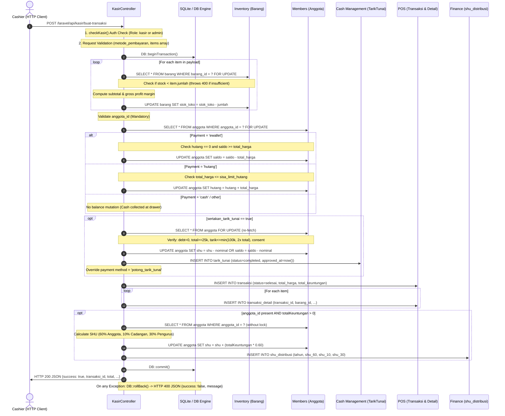

# Phase 8A: POS Checkout Architectural & Behavioral Pre-Verification Report

**Target Operation:** `KasirController::buatTransaksiKasir`  
**API Endpoint:** `POST /laravel/api/kasir/buat-transaksi`  
**Classification:** HIGH-RISK / REVENUE-CRITICAL  
**Phase Objective:** READ-ONLY Architectural, Concurrency, and Behavioral Verification  
**Repository State:** `main` at `05497e901e6e76f015a62c61f430c6ed6533610d` (Clean, 171 tests / 1275 assertions / 0 failures)  

---

## 1. Executive Summary

POS checkout (`KasirController::buatTransaksiKasir`) is the core revenue-generating operation of the cooperative system. It coordinates physical point-of-sale checkout at the cashier desk, handling retail merchandise sales, multiple payment methods, member debt limits, instant member patronage SHU allocation, and integrated cash withdrawal (`tarik_tunai`).

The architectural audit reveals that `buatTransaksiKasir` is a monolithic controller method of ~210 lines performing extensive direct cross-module writes across **POS**, **Inventory**, **Members**, **Finance**, and **Cash Management**. While it is contained within a single database transaction (`DB::beginTransaction() ... DB::commit()`), it suffers from significant concurrency hazards—specifically **iterative, unsorted row-level locking of inventory items** and **inverse lock acquisition order relative to member online ordering**, which creates direct deadlock and race condition vulnerabilities under concurrent cashier/member traffic.

---

## 2. Runtime Execution Path

The complete runtime execution sequence of `buatTransaksiKasir` follows:



---

## 3. API Contract Baseline

| Parameter | Type | Validation / Constraint | Description |
| :--- | :--- | :--- | :--- |
| `metode_pembayaran` | string | `required\|string` | Payment mode (`cash`, `ewallet`, `hutang`, etc.) |
| `items` | array | `required\|array` | Array of checkout line items |
| `items.*.barang_id` | integer | `required\|integer` | Catalog item ID |
| `items.*.jumlah` | integer | `required\|integer\|min:1` | Quantity to purchase |
| `items.*.harga_satuan` | numeric | Optional (unvalidated) | Custom price override (defaults to `barang.harga_jual`) |
| `anggota_id` | integer | Enforced in code (mandatory) | Member ID; missing throws 400 |
| `sertakan_tarik_tunai` | boolean | Optional | Flag to attach cash withdrawal |
| `tarik_tunai_nominal` | numeric | Optional ($\ge 0$) | Amount to withdraw |
| `tarik_tunai_sumber` | string | Optional (`shu` or `saldo`) | Source fund (defaults to `shu`) |
| `persetujuan_shu` | boolean | Optional | Master consent agreement flag |

**Response Contract:**
- **Success (200):**
  ```json
  {
    "success": true,
    "message": "Transaksi berhasil",
    "transaksi_id": 123,
    "total": 50000,
    "total_keuntungan": 10000,
    "tarik_tunai": null
  }
  ```
  *(If Tarik Tunai attached: `message` prompts cashier to hand over net cash `uang_bersih_diserahkan`, and `tarik_tunai` contains withdrawal receipt details).*
- **Failure (400):**
  ```json
  {
    "success": false,
    "message": "<Exception Message>"
  }
  ```

---

## 4. Payment Mode Matrix

| Mode | Allowed Conditions | Member Balance Checks | Member Balance Mutation | Downstream / Ledger Effect |
| :--- | :--- | :--- | :--- | :--- |
| **`cash`** | Mandatory valid member selected | None | None | Physical cash accepted at till; not recorded in `setoran_kasir`. |
| **`ewallet`** | Member must have 0 outstanding debt | `hutang == 0` AND `saldo >= total_harga` | `anggota.saldo -= total_harga` | Immediate digital wallet decrement. |
| **`hutang`** | Shopping within remaining credit limit | `total_harga <= sisa_limit_hutang` | `anggota.hutang += total_harga` | Increases accounts receivable (kasbon belanja). |
| **`potong_tarik_tunai`** | Replaces original payment method if withdrawal combined | `total_harga >= 25000`, `tarik <= min(100k, 2x belanja)`, `sumber_dana >= tarik` | `anggota.shu -= tarik` OR `anggota.saldo -= tarik` | Shopping is settled against withdrawal; cashier hands over `tarik - belanja`. |
| **`qr` / `transfer`** | Treated as non-wallet external payment | None | None | Functions identically to `cash` without wallet mutation. |

---

## 5. Database Mutation Matrix

| Table | Model / Accessor | Mutation Operation | Owning Domain (Phase 5 Map) | Authoritative Status |
| :--- | :--- | :--- | :--- | :--- |
| `barang` | `App\Models\Barang` | `stok_toko -= jumlah` | **Inventory** | **Cross-Module Write Violation** (POS mutates Inventory state) |
| `anggota` | `App\Models\Anggota` | `saldo -= total_harga` (ewallet) | **Members** | **Cross-Module Write Violation** (POS mutates Member balance) |
| `anggota` | `App\Models\Anggota` | `hutang += total_harga` (hutang) | **Members** | **Cross-Module Write Violation** (POS mutates Member debt) |
| `anggota` | `App\Models\Anggota` | `shu -= nominal` (tarik tunai) | **Finance / Members** | **Cross-Module Write Violation** (POS mutates Member SHU) |
| `anggota` | `App\Models\Anggota` | `shu += totalKeuntungan * 0.60` | **Finance / Members** | **Cross-Module Write Violation** (POS mutates Member SHU) |
| `anggota` | `App\Models\Anggota` | `persetujuan_shu_master_at = now()` | **Members** | **Cross-Module Write Violation** (POS updates Member consent) |
| `tarik_tunai` | `App\Models\TarikTunai` | `INSERT INTO tarik_tunai (status=completed)` | **Cash Management** | **Cross-Module Write Violation** (POS creates Cash Withdrawal) |
| `transaksi` | `App\Models\Transaksi` | `INSERT INTO transaksi (status=selesai)` | **POS** | Authoritative POS write |
| `transaksi_detail` | `App\Models\TransaksiDetail` | `INSERT INTO transaksi_detail (...)` | **POS** | Authoritative POS write |
| `shu_distribusi` | `DB::table('shu_distribusi')` | `INSERT INTO shu_distribusi (...)` | **Finance** | **Cross-Module Write Violation** (POS creates Global Finance record) |

---

## 6. Concurrency & Deadlock Vulnerability Analysis

### Risk 1: Iterative Unsorted Lock Ordering on Inventory Items (Severity: HIGH)
- **Current Behavior:** `foreach ($request->items as $item)` calls `Barang::where('barang_id', $item['barang_id'])->lockForUpdate()->first()`.
- **Hazard:** The order of row locks is controlled entirely by client request array ordering.
- **Deadlock Scenario:**
  - Cashier A checks out Cart: `[Item 10, Item 20]`
  - Cashier B checks out Cart: `[Item 20, Item 10]`
  - Cashier A locks `Item 10`; Cashier B locks `Item 20`.
  - Cashier A requests lock on `Item 20` (blocks); Cashier B requests lock on `Item 10` (blocks).
  - Database engine must break deadlock by aborting one transaction.

### Risk 2: Inverse Lock Acquisition Order Between Cashier and Member Checkout (Severity: CRITICAL)
- **Current Behavior:**
  - `KasirController::buatTransaksiKasir`: Locks `Barang` rows first, then locks `Anggota`.
  - `AnggotaController::simpanTransaksi`: Locks `Anggota` row first (line 284), then locks `Barang` rows (line 290).
- **Hazard:** Complete inverse lock hierarchy between two active endpoints operating on the exact same records.
- **Deadlock Scenario:**
  - Member initiates mobile order for Item 15 $\rightarrow$ Endpoint locks `Anggota`, then requests lock on `Item 15`.
  - Cashier checks out Item 15 for the same Member at register $\rightarrow$ Endpoint locks `Item 15`, then requests lock on `Anggota`.
  - **Deterministic Deadlock!**

### Risk 3: Client Price Override Vulnerability (Severity: HIGH)
- **Current Behavior:** `$harga_satuan = $item['harga_satuan'] ?? $barang->harga_jual;`
- **Hazard:** The controller validation rule for `items.*` validates only `barang_id` and `jumlah`. It does not restrict or validate `harga_satuan`. A rogue client or compromised frontend can inject `harga_satuan = 1` and purchase arbitrary goods for Rp 1.

### Risk 4: Duplicate Product IDs in Payload (Severity: MEDIUM)
- **Current Behavior:** Client sends `[{barang_id: 5, jumlah: 2}, {barang_id: 5, jumlah: 3}]`.
- **Hazard:** Lock is re-queried on the same row; two separate detail rows are created rather than being consolidated.

---

## 7. Financial Invariants

| Invariant | Existing Enforcement Mechanism | Location | Integrity Risk |
| :--- | :--- | :--- | :--- |
| **Total Price Integrity** | Sum of line subtotals ($harga \times qty$) | Lines 290–294 | Price override risk if client passes `harga_satuan` |
| **Non-Negative Store Stock** | Checked before decrement: `stok_toko >= jumlah` | Lines 286–288 | Well protected within transaction, but unsorted locking causes deadlocks |
| **No E-Wallet with Unpaid Debt** | Blocked if `anggota.hutang > 0` | Lines 319–321 | Protected within transaction |
| **E-Wallet Solvency** | Blocked if `anggota.saldo < totalHarga` | Lines 322–324 | Protected within transaction |
| **Debt Credit Ceiling** | Blocked if `totalHarga > sisa_limit_hutang` | Lines 330–333 | Relies on dynamic accessor `sisa_limit_hutang` (Rp 300.000 simpanan pokok + allowance) |
| **Cash Withdrawal Plafon** | Min belanja Rp 25k; Max 2x belanja; Plafon Rp 100k | Lines 355–364 | Enforced strictly in conditional block |
| **Instant Tripartite SHU** | 60% gross margin credited immediately to member SHU | Lines 444–459 | Creates sub-ledger record in `shu_distribusi`, but does so without row lock on member in final step |

---

## 8. Audit & Traceability Analysis

- **Business Audit Trail:**
  - Header record: `transaksi` captures `kasir_id`, `anggota_id`, `total_harga`, `total_keuntungan`, `metode_pembayaran`, `status` ('selesai'), and timestamps.
  - Detail records: `transaksi_detail` captures `barang_id`, `jumlah`, `harga_satuan`, `subtotal`, `keuntungan`.
  - Withdrawal record: `tarik_tunai` captures cashier approval and net cash handed over.
  - SHU distribution: `shu_distribusi` captures annual allocation amounts.
- **Audit Gaps:**
  - No snapshot of member balances (`saldo_before`, `saldo_after`, `hutang_before`, `hutang_after`) on the `transaksi` record.
  - No log of physical cash tendered or change given (`uang_diterima`, `kembalian` are not stored in database).
  - No audit log entry for cash drawer balance changes.

---

## 9. Existing Test Coverage & Characterization Gaps

### Existing Automated Coverage:
1. `KasirCompleteTest::test_buat_transaksi_kasir_cash_success`
2. `KasirCompleteTest::test_buat_transaksi_kasir_ewallet_missing_anggota`
3. `KasirCompleteTest::test_buat_transaksi_kasir_ewallet_has_hutang`
4. `KasirCompleteTest::test_buat_transaksi_kasir_ewallet_insufficient_saldo`
5. `KasirCompleteTest::test_buat_transaksi_kasir_hutang_limit_exceeded`
6. `KasirSopAuditTest::test_buat_transaksi_kasir_cash_success`
7. `KasirSopAuditTest::test_buat_transaksi_kasir_hutang_within_limit_success`
8. `KasirSopAuditTest::test_buat_transaksi_kasir_hutang_exceeding_limit_fails`
9. `KasirSopAuditTest::test_buat_transaksi_kasir_insufficient_stock_fails`
10. `KasirTest::test_kasir_can_process_cash_transaction_and_reduce_stock`
11. `KasirTest::test_kasir_can_process_hutang_transaction_and_increase_anggota_debt`
12. `KasirTest::test_kasir_cannot_process_transaction_if_stock_insufficient`
13. `TarikTunaiTest::test_buat_transaksi_kasir_with_tarik_tunai_and_auto_purchase_deduction`

### Identified Characterization Gaps (Prior to Extraction):
- ⚠️ **Zero test coverage for `shu_distribusi` table insertion during checkout.**
- ⚠️ **Zero test coverage verifying rollback consistency when a multi-item checkout fails on the Nth item.**
- ⚠️ **Zero test coverage for duplicate `barang_id` entries in `items` array.**
- ⚠️ **Zero test coverage for price manipulation / `harga_satuan` override in payload.**
- ⚠️ **Zero test coverage for Tarik Tunai validation edge cases during shopping (e.g., shopping < 25k, tarik > 2x shopping, tarik > 100k).**
- ⚠️ **Zero concurrency test asserting deadlock-free behavior under reverse item ordering.**

---

## 10. Dependency Graph & Module Ownership Map

```
POS Module (KasirController::buatTransaksiKasir)
 ├── Reads / Writes ──> POS Domain: Transaksi, TransaksiDetail
 ├── Cross-Module ────> Inventory Domain: Barang (stok_toko deduction)
 ├── Cross-Module ────> Members Domain: Anggota (saldo, hutang, shu, consent)
 ├── Cross-Module ────> Cash Management Domain: TarikTunai (withdrawal ticket)
 └── Cross-Module ────> Finance Domain: shu_distribusi (tripartite margin recording)
```

**Target Ownership Alignment:**
To achieve transitional architecture compliance, POS checkout must orchestrate discrete domain Actions rather than executing raw database mutations directly against alien module tables.

---

## 11. Proposed Action Extraction Candidates (Phase 8 Design)

Rather than maintaining a God Action or premature micro-actions, the logical boundary points are:

1. **`App\Actions\POS\ProcessPosCheckoutAction` (Orchestrator):**
   - Coordinates the overarching transaction boundary and workflow.
2. **Domain Collaboration (Transitional Actions):**
   - Inventory: Deduct storefront stock (`stok_toko`).
   - Members: Settle member payment (`ewallet` or `hutang`).
   - Cash Management: Process shopping cash withdrawal (`tarik_tunai`).
   - Finance: Record POS transaction margin SHU allocation (`shu_distribusi`).

---

## 12. Risk Register

| ID | Finding | Classification | Recommendation for Phase 8 |
| :--- | :--- | :--- | :--- |
| **R-01** | Client-order unsorted `lockForUpdate()` on `Barang` | **HIGH** | Sort unique `barang_id` ascending prior to lock acquisition in Phase 8 extraction. |
| **R-02** | Inverse lock order (`Barang` $\rightarrow$ `Anggota` vs `Anggota` $\rightarrow$ `Barang`) | **CRITICAL** | Standardize global lock hierarchy (always acquire `Anggota` before `Barang` or vice versa across all endpoints). |
| **R-03** | Unvalidated `harga_satuan` allows price tampering | **HIGH** | Ignore or validate client-provided prices; enforce authoritative catalog pricing. |
| **R-04** | Direct cross-module raw DB writes to `shu_distribusi` | **MEDIUM** | Encapsulate within Finance Action. |
| **R-05** | No cache busting for catalog/member caches | **LOW** | Document deferred cache inconsistency. |

---

## 13. Phase Status

- **Status:** **PHASE 8A COMPLETE — PRE-VERIFICATION ONLY**
- **Production Code Changes:** 0 (Untouched)
- **Database Schema Changes:** 0 (Untouched)
- **Implementation Status:** **NOT AUTHORIZED** (Awaiting human review of Phase 8A findings).
