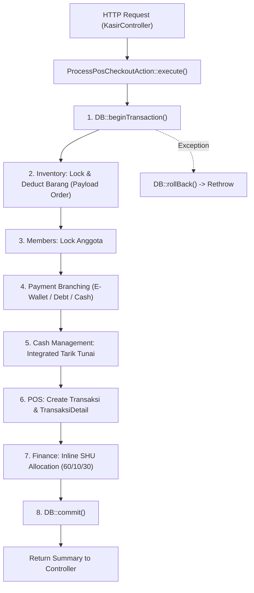
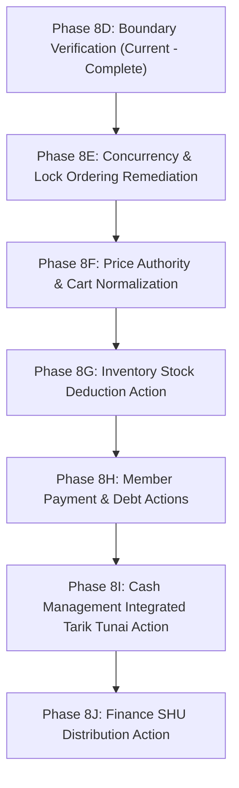

# Phase 8D: POS Checkout Boundary Verification Report

## 1. Executive Summary
Phase 8D performs a read-only architectural verification of the Point of Sale (POS) checkout workflow following the extraction in Phase 8C into `App\Actions\POS\ProcessPosCheckoutAction`.

The objective of this phase is not code modification, but determining the precise semantic module boundaries, domain ownership, transaction containment rules, concurrency risks, and an authoritative decomposition sequence for future refactoring phases.

**Key Finding:** `ProcessPosCheckoutAction` currently acts as a **Transitional Orchestration Action**. While it cleanly removes business logic from `KasirController`, it internally orchestrates and directly mutates state across **five distinct domain modules**:
1. **POS:** `transaksi`, `transaksi_detail`
2. **Inventory:** `barang` (`stok_toko`)
3. **Members:** `anggota` (`saldo`, `hutang`, `shu`)
4. **Cash Management:** `tarik_tunai`
5. **Finance:** `shu_distribusi`

All mutations currently execute within a single monolithic database transaction with client-controlled lock ordering. This document maps the clean separation of these boundaries, establishes strict transaction guidelines to avoid partial commits, assesses existing Action reuse, and outlines a prioritized roadmap for future modularization.

---

## 2. Current POS Action Architecture
`ProcessPosCheckoutAction::execute(array $data, int $kasirId): array` currently coordinates nine sequential steps:


---

## 3. Complete Runtime Dependency Map

| Model / Persistence | Target Domain Module | Operation in Action | Lock Type | Mutation Target |
| :--- | :--- | :--- | :--- | :--- |
| `App\Models\Barang` | **Inventory** | Query, Validate, Decrement | `lockForUpdate()` | `barang.stok_toko` |
| `App\Models\Anggota` | **Members** | Query, Validate, Mutate | `lockForUpdate()` | `anggota.saldo`, `anggota.hutang`, `anggota.shu`, `anggota.persetujuan_shu_master_at` |
| `App\Models\TarikTunai` | **Cash Management** | Create completed ticket | Implicit (Insert) | `tarik_tunai` row |
| `App\Models\Transaksi` | **POS** | Create transaction header | Implicit (Insert) | `transaksi` row |
| `App\Models\TransaksiDetail` | **POS** | Create transaction details | Implicit (Insert) | `transaksi_detail` rows |
| `DB::table('shu_distribusi')` | **Finance** | Insert distribution allocation | Implicit (Insert) | `shu_distribusi` row |

---

## 4. Boundary Analysis

### 4.1 Boundary A: POS → Inventory
- **Current Behavior:** POS loops through cart items, invokes `Barang::where('barang_id', ...)->lockForUpdate()->first()`, validates `stok_toko >= jumlah`, reads price (accepting client override), calculates subtotal and gross profit, and directly executes `$barang->stok_toko -= $item['jumlah']; $barang->save();`.
- **Domain Separation:**
  - **Inventory-Owned:** Stock availability validation, display stock decrement (`stok_toko`), tracking low stock/restock triggers, and providing authoritative unit pricing (`harga_jual`, `harga_modal`).
  - **POS-Owned:** Cart line items aggregation, line quantity requested, order subtotal calculation, order gross profit calculation, and transaction detail creation.
- **Proposed Future Inventory Capability:**
  - Semantic Name: `DeductSaleStockAction` or `FulfillStoreSaleItemsAction` (under `App\Actions\Inventory\`).
  - Required Input: Array of `['barang_id' => int, 'jumlah' => int]`.
  - Output: Array of fulfilled line items containing authoritative `['barang_id', 'harga_jual', 'harga_modal', 'jumlah']` or throw stock exception.
  - Transaction / Locking: Must execute within the parent transaction without calling `DB::commit()`. Must sort item IDs before locking.

### 4.2 Boundary B: POS → Members
- **Current Behavior:** POS directly reads `saldo`, `hutang`, `sisa_limit_hutang`, and mutates them inline based on payment method (`$anggota->saldo -= $totalHarga` or `$anggota->hutang += $totalHarga`).
- **Domain Separation:**
  - **Members-Owned:** Member identity verification, credit limit enforcement (`sisa_limit_hutang`), debt guard validation, wallet balance deductions, and debt increments.
  - **POS-Owned:** Choosing payment strategy, requesting member authorization, and capturing payment status in `transaksi`.
- **Proposed Future Members Capability:**
  - Member payment operations should be abstracted as Member domain capabilities:
    - `ProcessMemberWalletPaymentAction`
    - `RecordMemberCreditPurchaseAction`
  - Transaction / Locking: Must execute within the calling transaction without independent commit. `anggota.shu` increment should NOT be combined with payment mutation.

### 4.3 Boundary C: POS → Cash Management (Integrated Tarik Tunai)
- **Current Behavior:** If `sertakan_tarik_tunai` is requested, POS validates withdrawal eligibility, deducts funds from member `shu` or `saldo`, creates a completed `TarikTunai` ticket, overrides payment method to `potong_tarik_tunai`, and calculates `uang_bersih_diserahkan = max(0, nominal_tarik - total_belanja)`.
- **Domain Separation:**
  - **Cash Management-Owned:** Withdrawal business rules (minimum belanja threshold, 2x proportional ceiling, master consent validation, withdrawal code generation, `tarik_tunai` ticket persistence).
  - **POS-Owned:** Passing current order total to qualify withdrawal, receiving net cash figure, recording `potong_tarik_tunai` as transaction payment method, linking `transaksi_id` to ticket.
- **Action Reuse Feasibility:**
  - Existing `TarikTunaiAction` (Phase 6B) **CANNOT** be reused directly because:
    1. It initiates its own `DB::beginTransaction()` and calls `DB::commit()`.
    2. It validates against historical transactions from today (`created_at >= Carbon::today()`), whereas POS checkout qualifies against the *current in-flight* transaction.
    3. It assumes full cash handover, lacking the POS shopping net deduction (`max(0, nominal_tarik - total_belanja)`).
  - Recommendation: Extract a shared Cash Management internal sub-capability or dedicated `ProcessShoppingCashWithdrawalAction` that accepts an external transaction context and current order total.

### 4.4 Boundary D: POS → Finance (SHU Allocation)
- **Current Behavior:** If order profit is positive, POS calculates 60% member profit and 40% cooperative share, directly increments `anggota.shu`, and performs raw SQL insert into `shu_distribusi`.
- **Domain Separation:**
  - **POS-Owned:** Calculating gross profit from order items (`total_keuntungan`).
  - **Members-Owned:** Mutating the member's runtime `anggota.shu` balance.
  - **Finance-Owned:** Computing cooperative profit allocation (60/10/30) and maintaining the fiscal `shu_distribusi` distribution ledger.
- **Finding:** POS is currently performing all three concerns simultaneously. This is a classic cross-module leak. A future Finance capability (`RecordTransactionShuDistributionAction`) should handle the financial ledger entry and notify/coordinate member balance mutation.

---

## 5. Transaction Boundary Analysis
- **Current Invariant:** One atomic database transaction encapsulates all operations:
  $$\text{Inventory Deduction} \rightarrow \text{Member Mutation} \rightarrow \text{Tarik Tunai} \rightarrow \text{Transaksi Header/Details} \rightarrow \text{SHU Distribution}$$
- **Strict Rule for Future Decomposition:**
  - Any future domain Action invoked by POS checkout (e.g. `DeductSaleStockAction`, `ProcessMemberWalletPaymentAction`) **MUST NOT** manage its own transaction lifecycle (`DB::commit()`).
  - If a collaborator Action commits independently, any subsequent failure in POS checkout would cause a **catastrophic partial commit** (e.g. inventory decremented, member charged, but transaction header never created).
  - Therefore, the parent `ProcessPosCheckoutAction` must remain the single **Transaction Coordinator**, utilizing ambient Laravel database transactions.

---

## 6. Locking & Concurrency Analysis

### 6.1 Critical Finding: Lock Hierarchy Inversion
There is a confirmed architectural deadlock hazard between POS checkout and Mobile App checkout:
- **POS Checkout (`ProcessPosCheckoutAction`):**
  $$\text{Lock } \mathbf{Barang} \text{ (items 1..N)} \longrightarrow \text{Lock } \mathbf{Anggota}$$
- **Mobile Member Order (`AnggotaController::simpanTransaksi`):**
  $$\text{Lock } \mathbf{Anggota} \longrightarrow \text{Lock } \mathbf{Barang} \text{ (items 1..N)}$$

If a member submits an online order for an item at the exact moment a cashier scans the same item for that member at POS, the two processes acquire locks in opposite order, triggering an InnoDB database deadlock (`Deadlock found when trying to get lock; try restarting transaction`).

### 6.2 Secondary Finding: Payload-Controlled Lock Order
In `ProcessPosCheckoutAction`, items are locked in whatever order they appear in the client JSON payload:
```php
foreach ($data['items'] as $item) {
    $barang = Barang::where('barang_id', $item['barang_id'])->lockForUpdate()->first();
    ...
}
```
If Cashier 1 checks out `[Barang 10, Barang 20]` while Cashier 2 simultaneously checks out `[Barang 20, Barang 10]`, a multi-item deadlock can occur between two cashier terminals.
- **Classification:** **CRITICAL**.
- **Required Resolution:** Future concurrency remediation must standardize lock order across the entire application:
  1. Always acquire locks in a globally defined hierarchy (e.g., `Anggota` $\rightarrow$ `Barang`, or vice versa).
  2. Always sort multi-entity IDs ascending (`sort($barangIds)`) before acquiring row locks.

---

## 7. Price Authority Analysis
- **Current Behavior:** `ProcessPosCheckoutAction` reads `$harga_satuan = $item['harga_satuan'] ?? $barang->harga_jual;`.
- **Vulnerability:** The client (cashier terminal or external API caller) can pass an arbitrary `harga_satuan` (e.g. passing Rp 1.000 for a Rp 50.000 item).
- **Cascading Effects:**
  1. **Subtotal:** `subtotal = harga_satuan * qty` (customer is undercharged or overcharged).
  2. **Inventory/Sales Margin:** `keuntungan = (harga_satuan - harga_modal) * qty` (profit is skewed or becomes negative).
  3. **SHU Generation:** `shu60 = keuntungan * 0.60` (fictitious SHU credited to member balance and persisted to `shu_distribusi`).
- **Domain Authority:** **Inventory** is the sole authoritative owner of catalog selling prices (`barang.harga_jual`).
- **Classification:** **HIGH**.
- **Recommendation:** Inventory domain must supply the verified price. Client overrides should only be permitted if an explicit discount/override authorization mechanism (with audit trail) is introduced.

---

## 8. Duplicate Item Analysis
- **Current Behavior:** If `$data['items']` contains duplicate `barang_id` entries (e.g., `[{barang_id: 5, qty: 2}, {barang_id: 5, qty: 3}]`), POS locks and decrements stock for ID 5 twice, and persists two distinct `transaksi_detail` rows.
- **Evaluation:**
  - Semantically, a retail shopping receipt should normalize line items by product ID unless serial numbers or unique attributes are tracked.
  - In `AnggotaController::simpanTransaksi`, duplicate IDs are also processed iteratively without normalization.
  - This is an **Input Normalization / Cart Validation** concern belonging to the POS boundary before inventory deduction.
- **Classification:** **MEDIUM**.

---

## 9. Existing Action Reuse Analysis

| Action Class | Domain | Can Be Reused Directly in POS? | Reason / Architectural Conflict |
| :--- | :--- | :---: | :--- |
| `App\Actions\CashManagement\TarikTunaiAction` | Cash Management | **NO** | Manages own `DB::beginTransaction`/`commit`. Requires historical completed transactions from today; incompatible with in-flight POS transaction. Does not compute net cash handover. |
| `App\Actions\CashManagement\ProsesTarikTunaiAction` | Cash Management | **NO** | Operates on pending online withdrawal requests (`approve`/`reject`), not direct shopping withdrawals. |
| `App\Actions\Finance\ProsesKonversiShuAction` | Finance | **NO** | Converts accumulated SHU balance to shopping saldo or debt settlement; unrelated to transaction gross profit distribution. |
| `App\Actions\Inventory\RestockBarangAction` | Inventory | **NO** | Inbound inventory restocking with `riwayat_restock` ledger and expiry dates; unrelated to point-of-sale retail deduction. |
| `App\Actions\Finance\RecordPengeluaranOperasionalAction` | Finance | **NO** | Records administrative OPEX expenses; unrelated to retail checkout. |

---

## 10. `ProcessPosCheckoutAction` Size & Complexity Assessment
- **Status:** **Transitional Orchestrator**.
- **Current Size:** 239 lines of PHP.
- **Assessment:**
  - While significantly improved from the 1200+ line controller, `ProcessPosCheckoutAction` is still too broad for long-term modular architecture because it directly manipulates 5 database tables across 4 modules.
  - However, **premature micro-decomposition would be dangerous** without first resolving the lock hierarchy and transaction boundary rules.
  - It is appropriate and stable as a transitional orchestrator for Phase 8.

---

## 11. Ownership Conflict Matrix

| Operation | Current Owner in Code | Authoritative Owner | Current Mutation | Proposed Future Capability | Risk | Recommendation |
| :--- | :--- | :--- | :--- | :--- | :--- | :--- |
| **Etalase Stock Decrement** | POS (`ProcessPosCheckoutAction`) | **Inventory** | Direct `$barang->stok_toko -= $qty` | `Inventory::deductSaleStock()` | HIGH | Extract to Inventory module; enforce ascending lock order. |
| **Catalog Price Lookup** | Client payload override | **Inventory** | Accepts `$item['harga_satuan']` | `Inventory::getAuthoritativePrice()` | HIGH | Disallow arbitrary client price; enforce `barang.harga_jual`. |
| **Wallet Payment** | POS (`ProcessPosCheckoutAction`) | **Members** | Direct `$anggota->saldo -= $total` | `Members::chargeWallet()` | MEDIUM | Delegate to Members capability; enforce debt guard. |
| **Debt Purchase** | POS (`ProcessPosCheckoutAction`) | **Members** | Direct `$anggota->hutang += $total` | `Members::recordDebtPurchase()` | MEDIUM | Delegate to Members capability; check `sisa_limit_hutang`. |
| **Shopping Tarik Tunai** | POS (`ProcessPosCheckoutAction`) | **Cash Management** | Direct `TarikTunai::create()` | `CashManagement::processShoppingWithdrawal()` | MEDIUM | Encapsulate withdrawal logic; pass net cash to POS. |
| **SHU Member Mutation** | POS (`ProcessPosCheckoutAction`) | **Members** | Direct `$anggota->shu += $shu60` | `Members::creditShu()` | HIGH | Separate member balance update from fiscal ledger entry. |
| **SHU Fiscal Allocation** | POS (`ProcessPosCheckoutAction`) | **Finance** | Direct `shu_distribusi` insert | `Finance::recordDistribution()` | HIGH | Extract to Finance Action; maintain audit trail. |

---

## 12. Risk Register

| ID | Finding / Vulnerability | Severity | Impact | Mitigation Strategy |
| :--- | :--- | :---: | :--- | :--- |
| **R-01** | **Lock Hierarchy Inversion** (`Barang` $\rightarrow$ `Anggota` in POS vs `Anggota` $\rightarrow$ `Barang` in Mobile) | **CRITICAL** | Production database deadlocks under simultaneous POS and online checkout. | Dedicated concurrency phase to unify lock order across both entry points. |
| **R-02** | **Client-Controlled Lock Order** | **HIGH** | Deadlocks between concurrent cashiers checking out overlapping carts. | Sort `barang_id` ascending prior to acquiring row locks. |
| **R-03** | **Unvalidated Price Override** | **HIGH** | Arbitrary prices alter revenue, gross margins, and member SHU allocations. | Enforce catalog selling price from `barang.harga_jual`. |
| **R-04** | **Direct Multi-Module Persistence** | **HIGH** | Tightly couples POS to Finance, Members, and Cash Management schemas. | Decompose into sub-actions executing within ambient parent transaction. |
| **R-05** | **Duplicate Cart Line Processing** | **MEDIUM** | Duplicate database queries, redundant detail rows, and multiple stock decrements. | Normalize cart items in POS request validation layer. |
| **R-06** | **Lack of Financial Audit Trail** | **MEDIUM** | Member balances and SHU mutated directly without journal ledger entries. | Introduce double-entry ledger in dedicated financial architecture phase. |

---

## 13. Recommended Future Extraction Sequence

To minimize risk and prevent broken transaction boundaries, future decomposition should proceed in this strict order:



1. **Phase 8E: Concurrency & Lock Ordering Remediation (Prerequisite)**
   - Unify lock order across POS (`ProcessPosCheckoutAction`) and Mobile (`AnggotaController::simpanTransaksi`).
   - Implement deterministic ascending ID sorting for product locks.
2. **Phase 8F: Price Authority & Input Normalization**
   - Eliminate client-side price overrides. Ensure authoritative pricing derives from `Barang`.
   - Consolidate duplicate cart product IDs before processing.
3. **Phase 8G: Inventory Stock Deduction Extraction**
   - Extract `App\Actions\Inventory\DeductSaleStockAction`.
   - POS passes cart items; Inventory validates, locks, decrements, and returns verified prices/margins.
4. **Phase 8H: Member Payment & Debt Extraction**
   - Extract `App\Actions\Members\ProcessMemberPaymentAction`.
   - Encapsulate wallet deductions, debt limit validations, and debt increases.
5. **Phase 8I: Cash Management Shopping Withdrawal Extraction**
   - Extract `App\Actions\CashManagement\ProcessShoppingWithdrawalAction`.
   - Safely isolates `TarikTunai` ticket creation while returning net cash figures to POS.
6. **Phase 8J: Finance SHU Allocation Extraction**
   - Extract `App\Actions\Finance\RecordTransactionShuDistributionAction`.
   - Removes raw `shu_distribusi` SQL query from POS domain.

---

## 14. Deferred Remediation
In accordance with strict change control, **ZERO code changes were made in Phase 8D**. All findings, vulnerabilities, and boundary separations documented above remain intentionally deferred until explicit human authorization is granted for subsequent implementation phases.

---

## 15. Final Architectural Recommendation
Keep `ProcessPosCheckoutAction` intact as the top-level orchestration boundary for now. Do not perform piecemeal splitting until **Phase 8E (Concurrency & Lock Ordering)** establishes a deadlock-free, deterministic locking contract across all checkout channels.
