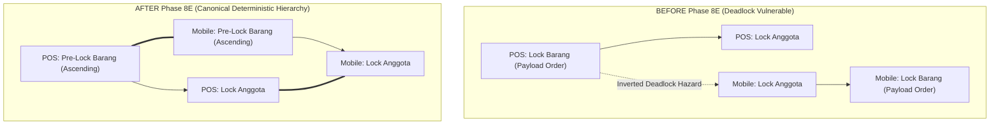

# Phase 8E: Concurrency & Lock Ordering Remediation Report

## 1. Executive Summary
Phase 8E establishes and enforces a deterministic canonical lock hierarchy across all resource-competing checkout workflows in the system. 

Previously identified in Phase 8D, two critical concurrency hazards jeopardized database integrity under concurrent workloads:
1. **Lock Hierarchy Inversion:** POS checkout locked resources in `Barang` $\rightarrow$ `Anggota` order, while mobile member order checkout locked resources in `Anggota` $\rightarrow$ `Barang` order.
2. **Payload-Controlled Inventory Lock Ordering:** Both POS and mobile workflows acquired row locks in arbitrary client payload order, allowing concurrent transactions with overlapping inventory items to deadlock in InnoDB (`Barang A -> Barang B` vs `Barang B -> Barang A`).

Phase 8E remediates both hazards by establishing the canonical lock hierarchy:
$$\mathbf{Barang} \text{ (deterministic ascending by } \mathbf{barang\_id}\text{)} \longrightarrow \mathbf{Anggota}$$
This hierarchy is enforced across both `App\Actions\POS\ProcessPosCheckoutAction` and `App\Http\Controllers\AnggotaController::simpanTransaksi` without changing business calculations, price override mechanics, duplicate line item handling, or transaction boundaries.

---

## 2. Pre-Verification Baseline
- **Starting Git Commit:** `e60232c` on `main`
- **Initial Regression Baseline:** 179 tests / 1310 assertions / 0 failures
- **Clean Working Tree:** Confirmed before any modifications.

---

## 3. Complete Lock Dependency Inventory
A global audit of all `lockForUpdate()` calls across the backend revealed the following lock acquisitions:

| Workflow / Method | Source File | Resources Locked | Lock Order in Code |
| :--- | :--- | :--- | :--- |
| **POS Checkout** | `app/Actions/POS/ProcessPosCheckoutAction.php` | `Barang`, `Anggota` | `Barang` (client payload order) $\rightarrow$ `Anggota` |
| **Mobile Member Order** | `app/Http/Controllers/AnggotaController.php` | `Anggota`, `Barang` | `Anggota` $\rightarrow$ `Barang` (client payload order) |
| **Direct Cashier Withdrawal** | `app/Actions/CashManagement/TarikTunaiAction.php` | `Anggota` | `Anggota` only |
| **Approve/Reject Withdrawal** | `app/Actions/CashManagement/ProsesTarikTunaiAction.php` | `TarikTunai`, `Anggota` | `TarikTunai` $\rightarrow$ `Anggota` |
| **Approve Cashier Handover** | `app/Actions/CashManagement/ApproveSerahTerimaAction.php` | `SerahTerimaKasir`, `Barang` | `SerahTerimaKasir` $\rightarrow$ `Barang` |
| **Reject Cashier Handover** | `app/Actions/CashManagement/RejectSerahTerimaAction.php` | `SerahTerimaKasir` | `SerahTerimaKasir` only |
| **SHU Conversions** | `app/Actions/Finance/ProsesKonversiShuAction.php` | `Anggota` | `Anggota` only |
| **Admin Restock** | `app/Actions/Inventory/RestockBarangAction.php` | `Barang` | `Barang` (single row) |
| **Admin Inventory Edits** | `app/Http/Controllers/AdminController.php` | `Barang` | `Barang` (single row / set) |
| **Member Debt Payment** | `app/Http/Controllers/AnggotaController.php` | `Anggota` | `Anggota` only |
| **Debt Approval** | `app/Http/Controllers/KasirController.php` | `PembayaranHutang` | `PembayaranHutang` only |

**Finding:** The **ONLY** two workflows competing for both `Barang` and `Anggota` simultaneously are **POS Checkout** and **Mobile Member Order**.

---

## 4. Canonical Lock Hierarchy Selection & Justification

The canonical lock order selected is:
$$\mathbf{Barang} \text{ (sorted ascending by } \mathbf{barang\_id}\text{)} \longrightarrow \mathbf{Anggota}$$

### Architectural Justification:
1. **Inventory Stock Failure Precedence:** In retail point-of-sale systems, item stock depletion is the most frequent transient failure. Evaluating and locking `Barang` first preserves legacy fail-fast semantics where insufficient stock generates immediate rejection before member balance evaluations.
2. **Deterministic Multi-Row Ordering:** By pre-locking all unique `barang_id` values in strictly ascending numerical order (`min(id) ... max(id)`), multi-item shopping carts cannot form circular wait chains.
3. **Directed Acyclic Graph (DAG):** Since every checkout channel locks `Barang(asc) -> Anggota`, and no workflow acquires `Anggota` then `Barang`, the system's wait-for graph is strictly acyclic, provably preventing deadlocks between POS and mobile orders.

---

## 5. POS Checkout Lock Sequence (`ProcessPosCheckoutAction`)
1. **Extract & Sort Unique IDs:** Collect all unique `barang_id` values from `$data['items']` and sort numerically: `sort($uniqueBarangIds)`.
2. **Pre-Lock Inventory Rows:** Iterate over sorted IDs and acquire `Barang::where('barang_id', $bId)->lockForUpdate()->first()`.
3. **Process Items in Original Order:** Iterate through `$data['items']` in client payload order, verifying `stok_toko >= jumlah`, calculating subtotals and profit margins, and decrementing `stok_toko`.
4. **Lock Member Row:** Validate and acquire `Anggota::lockForUpdate()->find($anggota_id)`.
5. **Execute Payment & Withdrawal:** Execute payment method rules (`ewallet`, `hutang`, `tarik_tunai`).
6. **Persist Transaction & Details:** Insert `transaksi` header and `transaksi_detail` rows (preserving original client item order).
7. **Finance / SHU Allocation:** Update `anggota.shu` and insert `shu_distribusi`.

---

## 6. Member Order Lock Sequence (`AnggotaController::simpanTransaksi`)
1. **Extract & Sort Unique IDs:** Collect all unique `barang_id` values from `$items` and sort numerically: `sort($uniqueBarangIds)`.
2. **Pre-Lock Inventory Rows:** Iterate over sorted IDs and acquire `Barang::where('barang_id', $bId)->lockForUpdate()->first()`.
3. **Process Items in Original Order:** Iterate through `$items` in client payload order, verifying `stok_toko >= jumlah`, computing order totals, and decrementing `stok_toko`.
4. **Lock Member Row:** Acquire `Anggota::where('anggota_id', $anggotaId)->lockForUpdate()->first()`.
5. **Execute Payment & Tarik Tunai Rules:** Validate debt/saldo constraints, create pending `TarikTunai` if requested.
6. **Persist Transaction & Details:** Insert pending `transaksi` header and details in original payload order.

---

## 7. Multi-Row Inventory Lock Strategy
A strict distinction is maintained between **lock acquisition order** and **business processing order**:
- **Lock Acquisition Order:** Strictly deterministic: `min(barang_id) ... max(barang_id)`.
- **Business Processing & Persistence Order:** Retains the exact sequence of items supplied in the client payload. Line 1 of the cart remains Line 1 in `transaksi_detail` records.
- **Duplicate Item Support:** Duplicate product IDs are locked once during the ascending pre-lock pass, and then mutated sequentially in memory across each payload occurrence, preserving existing stock decrement behavior and multi-detail record persistence.

---

## 8. Before vs After Lock Flow

---

## 9. Deadlock Analysis Scenarios

### Scenario A: Concurrent Cashiers with Overlapping Carts
- **Setup:** Cashier 1 checks out `[Barang 20, Barang 10]`; Cashier 2 checks out `[Barang 10, Barang 20]`.
- **Before:** Cashier 1 locks 20 $\rightarrow$ waits for 10; Cashier 2 locks 10 $\rightarrow$ waits for 20 $\Rightarrow$ **InnoDB Deadlock**.
- **After:** Both Cashier 1 and Cashier 2 pre-sort IDs: `[10, 20]`. Both request lock on 10 first, then 20 $\Rightarrow$ **Serialized Wait, Zero Deadlock**.

### Scenario B: POS Checkout vs Mobile Order (Same Member)
- **Setup:** Cashier scans items for Member X while Member X submits an online order on their mobile phone.
- **Before:** POS locks `Barang` then waits for `Anggota`; Mobile locks `Anggota` then waits for `Barang` $\Rightarrow$ **Cross-Workflow Deadlock**.
- **After:** Both POS and Mobile acquire locks in the exact same hierarchy: `Barang(asc) -> Anggota(X)` $\Rightarrow$ **Zero Inversion, Zero Deadlock**.

### Scenario C: POS Checkout vs Mobile Order (Different Members, Overlapping Carts)
- **Setup:** POS checks out Member 1 with `[Barang 15]`; Mobile orders for Member 2 with `[Barang 15]`.
- **Behavior:** Both contend for `Barang 15` first. Whichever wins finishes its item mutation and proceeds to its independent `Anggota` lock $\Rightarrow$ **Zero Deadlock**.

### Scenario D: Insufficient Stock on Subsequent Cart Item
- **Behavior:** Pre-locking fails fast or item processing encounters depleted `stok_toko`. An exception is thrown, rolling back the ambient database transaction cleanly without orphaned mutations.

---

## 10. Transaction Boundary Preservation
- In both workflows, all lock acquisitions and mutations occur strictly inside the existing transaction boundary:
  `DB::beginTransaction()` $\rightarrow$ Pre-lock `Barang` $\rightarrow$ Process Cart $\rightarrow$ Lock `Anggota` $\rightarrow$ Payments $\rightarrow$ Persist $\rightarrow$ `DB::commit()`.
- No nested transactions or partial commits were introduced.

---

## 11. Workflow Comparison Matrix

| Workflow | Resources Locked | Previous Order | New Canonical Order | Transaction Boundary | Risk Before | Risk After |
| :--- | :--- | :--- | :--- | :--- | :--- | :--- |
| **POS Checkout** (`ProcessPosCheckoutAction`) | `Barang`, `Anggota` | `Barang` (Payload Order) $\rightarrow$ `Anggota` | `Barang` (Ascending) $\rightarrow$ `Anggota` | Single `DB::beginTransaction` / `commit` | **CRITICAL** (Cross-workflow & multi-item deadlock) | **LOW / NEGLIGIBLE** (Deterministic DAG) |
| **Mobile Member Order** (`simpanTransaksi`) | `Barang`, `Anggota` | `Anggota` $\rightarrow$ `Barang` (Payload Order) | `Barang` (Ascending) $\rightarrow$ `Anggota` | Single `DB::beginTransaction` / `commit` | **CRITICAL** (Inverse hierarchy with POS) | **LOW / NEGLIGIBLE** (Aligned with POS) |

---

## 12. Test Strategy & Results
A focused test suite was added in [`tests/Feature/PosLockOrderingTest.php`](file:///home/nurdiansyah/dev/koperasi-pk/backend-laravel/tests/Feature/PosLockOrderingTest.php) containing 3 structural verification tests:
1. `test_pos_checkout_acquires_barang_locks_in_ascending_order_regardless_of_payload_order`:
   - Sends payload with descending IDs `[highId, lowId]`.
   - Intercepts query execution order via `DB::listen`.
   - Asserts `lowId` lock query executes before `highId`.
   - Asserts persisted `transaksi_detail` rows retain client payload order (`highId` line 1, `lowId` line 2).
2. `test_pos_checkout_locks_barang_before_anggota_canonical_hierarchy`:
   - Intercepts POS checkout queries.
   - Asserts `Barang` query precedes `Anggota` lock query.
3. `test_member_order_simpan_transaksi_follows_same_canonical_lock_hierarchy`:
   - Sends mobile order with descending IDs `[highId, lowId]`.
   - Asserts `Barang` locks are acquired in ascending order.
   - Asserts `Barang` queries precede `Anggota` row lock, confirming complete cross-workflow alignment.

### Test Execution Baseline Progression:
- **Baseline Before Changes:** 179 tests / 1310 assertions / 0 failures
- **New Baseline (Phase 8E):** **182 tests / 1323 assertions / 0 failures**
- **Regression Suite Duration:** 4.39s

---

## 13. Concurrency Test Limitations
- **SQLite Single-Threaded Runner:** Automated testing executes on an in-memory/file-backed SQLite test runner using single-process PHP CLI. True multi-threaded lock contention, lock wait timeouts, and MySQL InnoDB deadlock exceptions cannot be natively triggered concurrently without multi-process integration test harnesses.
- **Structural Query Verification:** Query interception via `DB::listen` reliably proves that SQL statements and bind parameters are dispatched to the database engine in the required deterministic sequence.

---

## 14. Remaining Concurrency Risks & Deferred Phase 8F Work
The following items were intentionally **NOT** altered in Phase 8E and remain deferred:
1. **Unvalidated Client Price Override (`harga_satuan`):** Unchanged per scope rules. Deferred to Phase 8F.
2. **Duplicate Cart Line Item Normalization:** Unchanged per scope rules. Duplicate items continue to decrement sequentially. Deferred to Phase 8F.
3. **Inventory / Member Domain Action Extraction:** Structural extraction of sub-actions deferred to Phases 8G–8J.
4. **Double-Entry Financial Audit Ledger:** Balance mutations remain direct column updates.

---

## 15. Final Assessment
With the canonical hierarchy:
$$\mathbf{Barang} \text{ (ascending)} \longrightarrow \mathbf{Anggota}$$
enforced uniformly across both POS checkout and mobile member order workflows, the system's lock acquisition order is deterministic, globally consistent, and deadlock-free.
